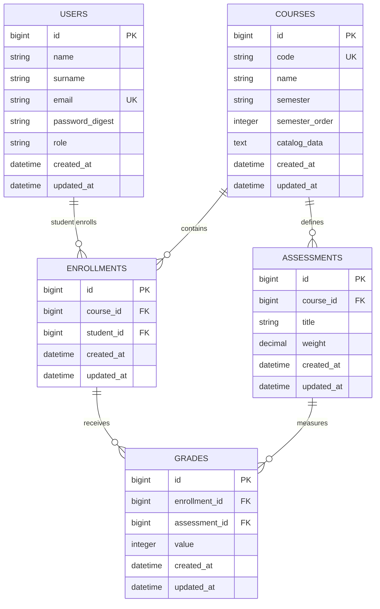

# Gradebook — project report

**Module:** CS403, Engineering Advanced Web Applications

**Academic session:** 2026/2027

**Source brief:** [`aewa-coursework.pdf`](../aewa-coursework.pdf)

**Implementation:** Rails 8.1, ERB, SQLite (development/test), PostgreSQL (production)

## 1. Project discussion

Gradebook implements a small university grade registry with two authenticated roles and a public course catalog. It follows the brief's instructor-led model: instructors create accounts, define courses and assessments, enroll students and record results. Students can inspect their own grades without modifying academic records.

A server-rendered Rails monolith is appropriate for this scope. It keeps authorization and validation on the server, needs no separate frontend deployment, and provides conventional resource-oriented controllers. Small vanilla JavaScript enhancements supply the requested semester filter and statistics popup. A consistent green-and-white interface separates the public catalog from the instructor and student workspaces while keeping navigation and login status visible.

The implementation favors shared rules over duplicated logic. Models validate records for both HTML forms and APIs. `GradeSummary`, `CourseStatistics`, `Transcript` and `SubmitGrades` implement calculations and multi-record operations. Controllers authenticate requests, select permitted records, invoke this logic and render either ERB or JSON.

## 2. Database ER diagram

GitHub renders the following Mermaid diagram directly. Required fields and unique constraints are described below.



- **Users:** one table holds both roles, so a case-insensitive unique email index covers instructors and students together. Passwords use bcrypt digests; plaintext passwords are never stored. Only student-role users may be enrolled.
- **Courses:** a globally unique code identifies the record. `semester_order` is a derived sortable integer, not a second independent user input.
- **Assessments:** each belongs to one course. `(course_id, title)` is unique. Decimal weights avoid binary floating-point errors when requiring a total of exactly 1.
- **Enrollments:** a join between a course and student. `(course_id, student_id)` is unique; no additional editable enrollment attributes are needed.
- **Grades:** one grade per enrollment and assessment, enforced by a unique `(enrollment_id, assessment_id)` index. Validation requires the assessment and enrollment to refer to the same course.

Foreign keys preserve references. Database checks constrain grade and weight ranges and the user role. Other detailed validations reside in Active Record. Deleting an enrollment removes its grades; deleting a student removes their enrollments and grades; deleting a course removes all its enrollments, grades and assessments. Destructive UI controls explain these effects and request confirmation.

## 3. Functional requirements mapping

| Coursework requirement | Implementation |
| --- | --- |
| Anonymous course listing for five semesters with enrollment counts | `WelcomeController`, `Course.recent`, `/welcome` |
| Course roster hyperlinks requiring authentication | Nested `EnrollmentsController#index`; shared login guard |
| Instructor/student login and correct landing view | `SessionsController`, role-specific `DashboardController` templates |
| Instructor personal information | `/profile/edit`, `ProfilesController` |
| Full student CRUD | `StudentsController`, shared user fields and `User` validations |
| Full course CRUD and optional catalog data | `CoursesController`, `Course` validations |
| Course assessments and weights | Nested `AssessmentsController`, `Assessment` validations |
| Roster list/add/delete | Nested enrollment routes; no enrollment update action |
| Per-student, per-course grade CRUD | Nested `GradesController`, contextual record lookup |
| Student dashboard and weighted results | `GradeSummary`, student dashboard, read-only grade table |
| Logout to welcome | DELETE `/logout`, resets the session and redirects |
| All listed validation limits | Models and corresponding HTML constraints; model/request tests |
| Transcript API and inclusive optional semester range | `Api::V1::TranscriptsController`, `Transcript` |
| Batch grade submission API | `Api::V1::GradesController`, transactional `SubmitGrades` |
| Instructor-only student ICRUD API | `Api::V1::StudentsController` |
| Client-side semester filter | `application.js`, catalog `data-semester` values |
| Popup grade statistics | Native HTML dialog, public aggregate JSON, `CourseStatistics` |
| Shared login header and understandable errors | Application layout, shared error partial, JSON error handlers |
| Rails 8+, ERB and production PostgreSQL | Rails 8.1, `.erb` templates, environment-specific database configuration |
| Minimum seeds | 1 instructor, 10 students, 10 courses, 300 grades |
| DRY across UI/API | Shared models, grade summaries, transcript and import services |
| GitHub/report/ER documentation | Repository, README and this report |
| Render deployment | Blueprint and build script ready; live deployment pending Render access |

## 4. Validation and grading policy

User names and surnames are required, limited to 30 characters each and 50 combined (excluding the display separator). Email is required, normalized, checked with an anchored address regex and unique across roles. Passwords need at least eight characters and uppercase, lowercase and numeric characters. bcrypt also limits passwords to its supported byte length. Blank passwords on an edit retain the current password.

Course code, name and semester are required. Codes are 5–6 characters and normalized to uppercase. Names are limited to 50 characters, semesters to 10 and descriptions to 500. Assessment titles are required, at most 30 characters and unique within the course. Weights are decimal fractions in the inclusive range 0–1. Grades are required integers in the inclusive range 0–120.

Assessment plans may be built incrementally. Before grade entry, the stored weights must total exactly 1. Weights cannot exceed 1 during construction. With existing grades, weight changes or weighted assessment deletions cannot invalidate a complete plan. Zero-weight assessments are supported and, like all defined assessments, require a grade for the result to be considered complete.

For a completed course, the result is:

```text
overall = Σ(weight_i × grade_i)
        = 0.25 × 80 + 0.35 × 70 + 0.40 × 90
        = 80.5
```

The shared service returns results rounded to two decimal places; the HTML dashboard displays one decimal place. There is no cap at 100. Incomplete results have `overall_grade: null`, a progress count and an earned-points subtotal. This distinguishes an ungraded assessment from a genuine score of zero.

Statistics use completed student overall results, rounded as above. `count` counts those completed results, while `enrolled_count` includes all enrolled students. Min/max/mean and population standard deviation describe this same population. Empty populations return null measures; a single result has standard deviation zero. Public aggregate access follows the explicit brief, although small cohorts would warrant a privacy threshold in a real deployment.

## 5. Semester and course interpretation

The brief gives `Fall 2016` as an example but permits only ten characters. `Spring 2026` would exceed that limit. The app therefore uses `Spr YYYY`, `Sum YYYY` and `Fall YYYY`, with a helper translating each term to `year × 3 + term_index` for sorting and comparisons. The calendar is documented in the README and can be centralized in `Semester` if the university uses different term dates.

“Last five semesters” means the current calendar term plus the previous four, rather than the latest five terms that happen to contain records. Future and older courses remain in instructor management but do not enter the public catalog. Semester filtering operates on already-rendered cards and does not request another page.

Although the scenario anticipates repeated offerings, the brief explicitly requires globally unique course codes. This prototype follows that rule. A future expansion should split `Course` (catalog code and description) from `CourseOffering` (semester, instructor and assessments) and make `(course_id, semester)` unique for offerings.

## 6. Security and error handling

HTML authentication uses a signed/encrypted Rails cookie session and resets the session at login/logout. Production uses HTTPS and secure, HTTP-only, SameSite cookies. Rails CSRF protection applies to form writes. Login attempts are rate-limited with Rails' controller facility; the prototype's memory cache provides a per-process limit.

API requests use HTTP Basic credentials and do not recognize browser cookies. Students are explicitly restricted to their own transcript; every student-management or grade-write API requires an instructor. HTML grade lookups first select the course and then an enrollment scoped to the current student, preventing guessed IDs from revealing another student's grades. Roster names are visible after authentication, while email addresses and grade links are instructor-only.

Strong parameters exclude role assignment and unrelated fields. ERB escapes user content, the statistics dialog builds DOM nodes with `textContent`, and a restrictive Content Security Policy disallows inline scripts and third-party resources. The app stores no external-service credentials in the repository. Validation failures display full, user-readable messages. Missing protected records return a generic not-found page or JSON error.

Batch imports use a database transaction and acquire a course lock while processing entries. The UI uses the same course lock for assessment edits and grade writes. A failed batch preserves previously stored values and inserts nothing. Unique indexes provide a final defense against duplicate writes. Instructor roles share one registry, consistent with the single-instructor prototype; institutional tenant/department isolation is future work.

## 7. Project documentation and operations

See the [README](../README.md) for local installation, demo logins, a workflow walkthrough, test commands, deployment instructions and project layout. See [API.md](API.md) for authentication, payloads, response shapes, curl commands and errors.

The Render Blueprint provisions one Ruby web service plus PostgreSQL. Its build step installs dependencies, compiles assets and migrates the database. Explicit demo seeding initializes coursework accounts. A generated `SECRET_KEY_BASE` protects production sessions, and `DATABASE_URL` points to the Render database. Secrets use environment variables. The health endpoint is `/up`.

The seed script is deterministic and fills missing records without resetting existing grades/passwords. It creates 100 enrollments and three grades for each, exceeding the required 50 grades. Production requires a chosen password. Disable seeding after the first deploy to preserve later intentional deletions.

## 8. Verification and evaluation

The automated suite tests the brief's weighted example; incomplete and extra-credit grades; validation boundaries; assessment plan consistency; semester ordering; statistics; dependency deletion; public pages; instructor forms and CRUD; login/logout; student restrictions; API authentication; all student API operations; transcript ownership and filters; grade upsert behavior; and rollback of an invalid batch.

A first test pass exposed a stale-association issue in assessment totals and a missing JSON error format. The implementation now calculates stored weights from the database and returns format-appropriate not-found errors. The corrected suite passes on both SQLite and an isolated PostgreSQL 14 database: **30 tests, 277 assertions, zero failures or errors**. Rails eager loading and production asset compilation also pass. See `test/` for executable evidence and the GitHub Actions workflow for repeatable verification.

No browser backend was available during implementation, so responsive layout, keyboard behavior and live JavaScript interaction require a final manual browser check. The README supplies a walkthrough. A Render deployment cannot be claimed until an authenticated deployment completes and returns a working URL.

## 9. Future development

For a university-wide registry, introduce separate course offerings, instructor/department ownership and fine-grained roles. Add an immutable audit trail for grade edits, account invitations and password-reset email, explicit grading-plan publication/versioning, pagination, bulk roster import, backups, and monitored deployments. Account/session revocation and shared rate limiting would strengthen authentication across multiple instances; token-based API credentials would avoid repeated Basic-password use.

The current prototype intentionally excludes GPA/letter-grade conversion because the brief specifies numeric weighted results without a grading scale. It also omits attendance, student self-registration and enrollment editing because none is requested. Large concurrent imports would benefit from deterministic global lock ordering and deadlock retries. The current synchronous batch is bounded to 500 entries. Cross-course grade consistency is an application invariant, so direct database writes must not bypass it.

## References

- Supplied [CS403 coursework brief](../aewa-coursework.pdf).
- [Ruby on Rails Getting Started guide](https://guides.rubyonrails.org/v8.0/getting_started.html).
- [Rails upgrade requirements](https://guides.rubyonrails.org/upgrading_ruby_on_rails.html).
- [Deploy a Rails 8 app on Render](https://render.com/docs/deploy-rails-8).
